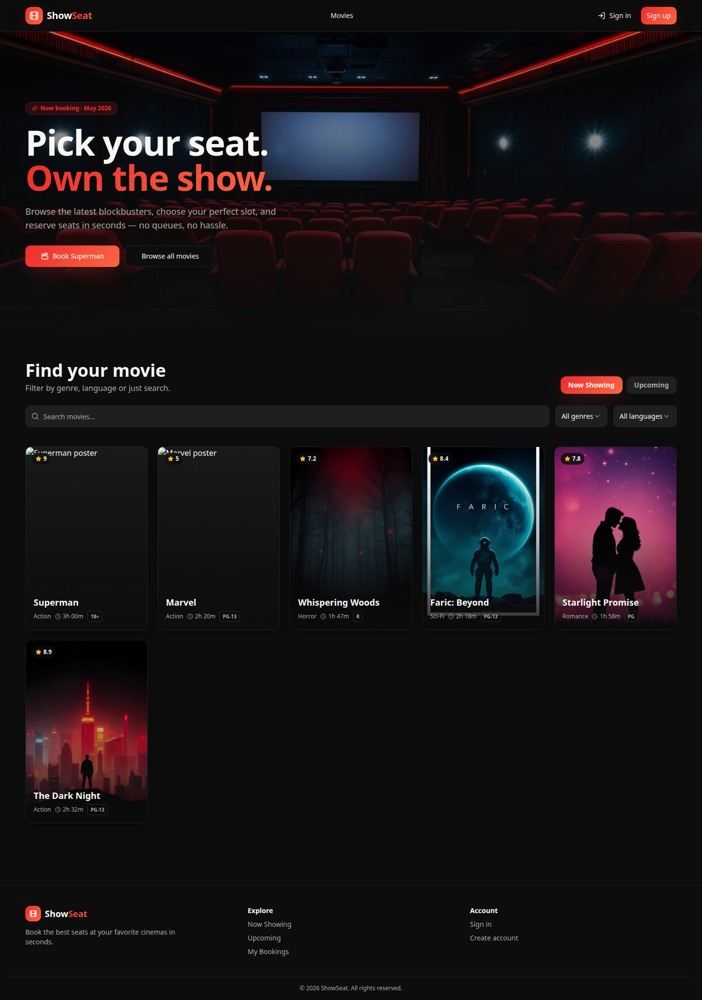
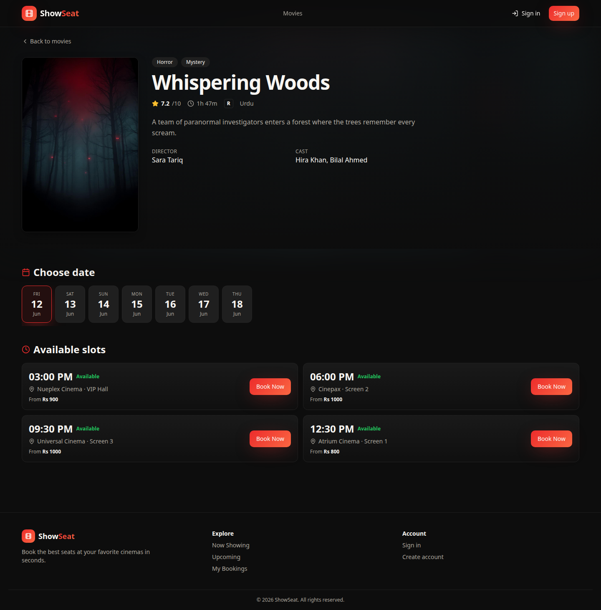
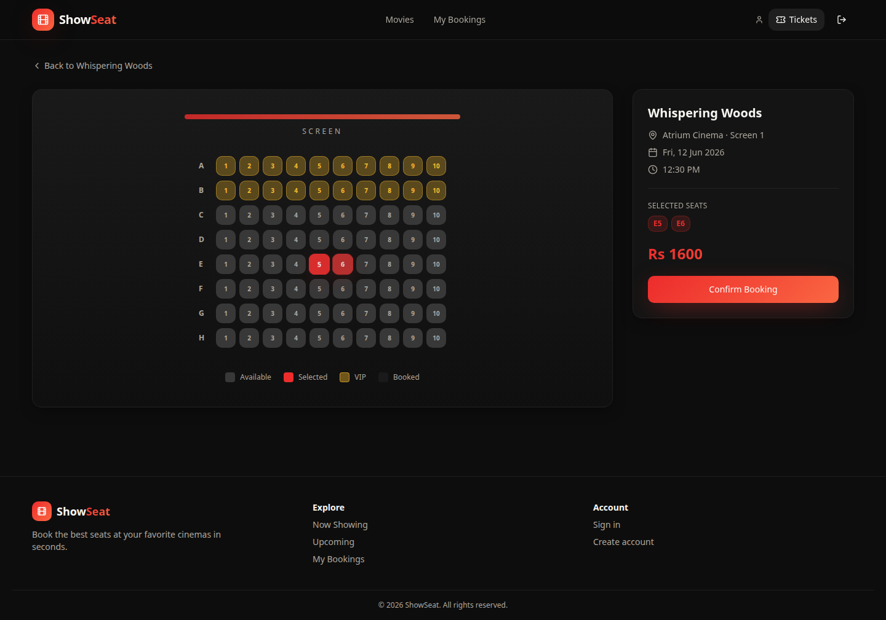
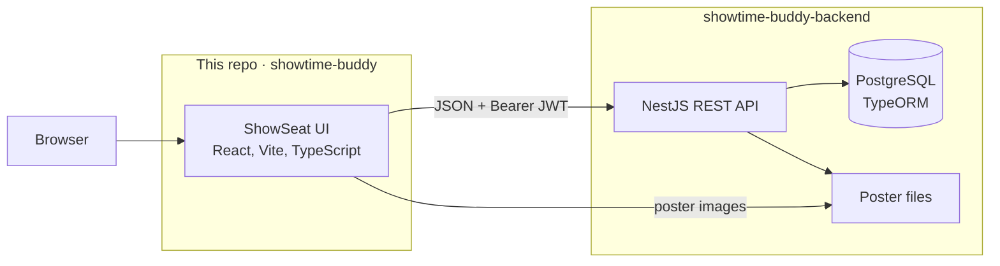

# ShowSeat — Real-Time Cinema Seat Booking

ShowSeat is a cinema booking web app: browse what is playing, pick a showtime, and reserve seats on an interactive seat map. Admins manage the catalog, schedules, and bookings from the same app. This repository is the frontend. The API lives in a separate repo and is not renamed here.

## Live demo

**https://maarijwaseem2-showtime-buddy.vercel.app**

## Screenshots

| Home | Showtimes |
| --- | --- |
|  |  |

## Features

Verified against this frontend and the [backend](https://github.com/maarijwaseem2/showtime-buddy-backend).

**Browse movies and showtimes**

- Now showing and upcoming catalogs, with search plus genre and language filters.
- Movie detail page with poster, cast, and a seven-day date strip.
- Showtimes for the selected date, including cinema, screen, standard and VIP prices, and how full the show is.

**Seat map**

- Interactive map for a showtime: available, selected, VIP, and already booked seats.
- Availability is loaded when the map opens, so the grid matches seats booked so far.
- Standard and VIP prices are totaled before confirm. Creating a booking requires a signed-in user.
- The API rejects a seat that was taken in the meantime, inside a database transaction.
- Confirmation page, a personal bookings list, and cancellation.

**Admin panel** (signed-in users with the `ADMIN` role)

- Overview: total bookings, seats sold, revenue, and most-booked titles.
- Movies: create, edit, delete, and upload a poster.
- Schedules: add or remove showtimes on an existing screen (date, start time, standard price, VIP price).
- Bookings table across customers.

**Screen layouts**

Each screen in the API stores its rows, column count, and VIP rows (defaults are rows A–H, 10 seats across, VIP on A and B). The booking page renders that default grid and paints VIP rows from the seats response. The admin panel assigns a showtime to an existing screen. It does not yet edit the grid itself.

Accounts also include sign up, sign in, and account recovery.

## Architecture

| Piece | Where it lives |
| --- | --- |
| Frontend (this repo) | [maarijwaseem2/showtime-buddy](https://github.com/maarijwaseem2/showtime-buddy), on Vercel |
| API | [maarijwaseem2/showtime-buddy-backend](https://github.com/maarijwaseem2/showtime-buddy-backend) (NestJS) |
| Data | PostgreSQL via TypeORM. Movies, users, cinemas, screens, showtimes, and bookings |
| Auth | JWT access token stored in the client. Admin routes require the `ADMIN` role |

The UI never talks to the database directly. Poster images are served by the API.

## Tech stack

**Frontend**

- React 18 and TypeScript
- Vite 5
- Tailwind CSS and Radix UI
- React Router
- TanStack Query
- Zustand
- React Hook Form and Zod

**Backend** (separate repository)

- NestJS
- TypeORM and PostgreSQL
- JWT and bcrypt
- Poster uploads

## Roadmap

- Admin editor for screen layouts (rows, columns, VIP rows), and a seat map that follows a non-default layout.
- Seat-map refresh while the page is open, so other bookings appear without a reload.
- Checkout hold so a selected seat is reserved for a short window before payment.
- Card or wallet payments.
- Email delivery for account-recovery codes.

## Author

**Syed Abdul Maarij**

- GitHub: [maarijwaseem2](https://github.com/maarijwaseem2)
- LinkedIn: [linkedin.com/in/maarijwaseem2](https://www.linkedin.com/in/maarijwaseem2)
